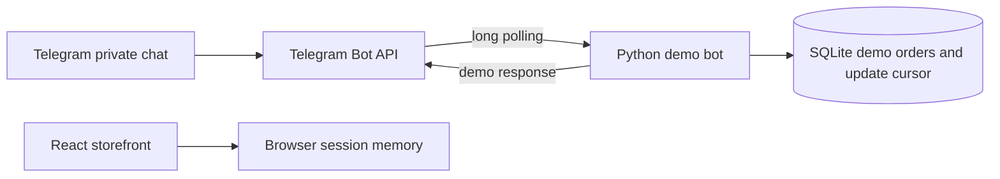

<!-- coderabbit-ai-generated:v1 -->

# Telegram demo bot architecture

The existing storefront remains a browser-only demo. This bot is a separate Python process; its orders do not appear in the storefront. Both use sample products and neither takes payment or fulfills orders.



## Run locally

Python 3.10 or newer is required; no Python packages are needed. Create a bot with Telegram's BotFather, then set environment variables in your shell (or load a private local `.env` file yourself). `.env.example` lists the variables; the application reads the process environment, not the file automatically. Keep the token private.

```sh
export TELEGRAM_BOT_TOKEN='your-bot-token'
export BOT_DATABASE_PATH='bot-demo.sqlite3'
python3 -m bot.app
```

Send `/start`, `/catalog`, `/order 1`, or `/orders` in a private chat with the bot. Stop with Ctrl+C. Only one polling process should use a bot token, and Telegram webhooks must be disabled before polling. Run tests with `python3 -m unittest discover -s tests`.

## Data and flow

<!-- coderabbit-ai-generated:v1 -->

<!-- coderabbit-ai-generated-section:v1:d0a3d6a81568b90d71a475bb0ab65acfb4073076da0b893b787e7939d6b86dde -->

`orders` stores a Telegram update ID, private chat ID, product name, integer price in cents, and creation time. `state` stores the next update offset and the last update time. Order creation and cursor advancement share a transaction, so a repeated update cannot create another order. After six days without an update, the bot clears its cursor before polling because Telegram may choose a new update ID sequence after a week.

<!-- /coderabbit-ai-generated:v1 --> Only the originating chat can list its orders. The cursor is committed before a reply is sent; if sending fails, the reply may be lost. SQLite and the bot are suitable for local demos, not multi-instance deployment. The local database contains chat IDs and should be protected and backed up appropriately.

## Modernization path

1. Agree on the product catalog, customer identity, order lifecycle, payment providers, and deployment requirements before building shared APIs.
2. Move the duplicated catalog and orders to a server-owned database; define migrations and authenticated storefront and bot interfaces. Calculate prices server-side and snapshot order items and currency.
3. Integrate provider-hosted card checkout and crypto invoices. Verify signed provider events, use idempotency keys, reconcile settlement, and fulfill only after verified payment. Add refunds and expiry states.
4. Add retryable notifications, structured logs without secrets, health checks, backups, rate limits, and integration tests for provider failures. Use a production database and secret manager for deployment.

No live Telegram, card, crypto, shipment, or provider integration is claimed by the storefront demo. This bot uses Telegram when configured, but simulates orders only.
